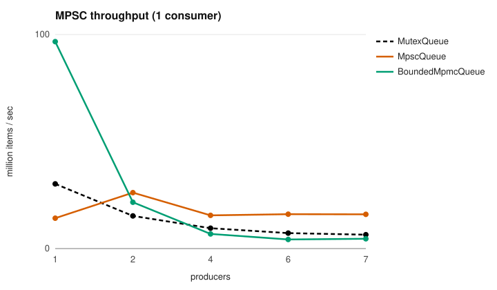

# Atom

A lock-free concurrency library in C++20: SPSC and MPSC queues built from atomics, not
`std::mutex`, with every memory ordering written out and justified, plus hazard pointers
and epoch-based reclamation on a Treiber stack. Everything is stress-tested under
ThreadSanitizer and AddressSanitizer, and benchmarked for throughput and tail latency
against a mutex-protected queue as the producer and consumer counts grow.

## Results (Apple M1 Pro, macOS, medians of 5 runs)



**MPSC, 1 consumer, million items/sec:**

| producers | MutexQueue | MpscQueue (Vyukov) | BoundedMpmcQueue |
|---|---|---|---|
| 1 | 30.2 | 14.2 | **96.7** |
| 2 | 15.2 | **26.1** | 21.7 |
| 4 | 9.5 | **15.5** | 6.8 |
| 7 | 6.5 | **16.0** | 4.6 |

**MPSC latency at a fixed load (p50 / p99):**

| producers | MutexQueue | MpscQueue | BoundedMpmcQueue |
|---|---|---|---|
| 2 | 17.9 µs / 328 µs | 251 ns / 5.2 µs | 195 ns / 719 ns |
| 4 | 32.8 µs / 2.4 ms | 735 ns / 1.1 µs | 407 ns / 863 ns |
| 7 | 14.6 µs / 2.1 ms | 799 ns / 9.7 µs | 431 ns / 3.0 µs |

What the numbers say:

- **The Vyukov MPSC queue is the one that holds up as producers are added**: 1.6 to 2.5 times the
  mutex queue from 2 to 7 producers. One `exchange` per push never retries.
- **A CAS-based ring collapses under producer contention**: BoundedMpmcQueue is fastest
  with one producer (97 M/s) and slowest from four on (under 7 M/s).
- **Lock-free wins the tail everywhere**: p50 in hundreds of nanoseconds against tens of
  microseconds, and p99 in microseconds where the mutex queue reaches milliseconds.
- **It does not win everything.** With 4 threads on either side the mutex queue moves more
  items per second than the MPMC ring; the mutex stack beats the Treiber stack at every
  thread count (no allocation, no CAS retries); the padded, cached-index SPSC queue was no
  faster than the naive one because the consumer kept the queue empty; and a single
  producer on the MPSC queue saturates at 1 to 2 M/s when items are paced one at a time.

Method, every table, charts and limits: [`docs/BENCHMARKS.md`](docs/BENCHMARKS.md).

## What is in it

| Header | Structure | Progress | Notes |
|---|---|---|---|
| `mutex_queue.hpp` | `MutexQueue<T>` | blocking | The baseline: a `std::mutex` around a fixed ring |
| `spsc_queue.hpp` | `SpscQueue<T>`, `NaiveSpscQueue<T>` | wait-free | Ring; release/acquire on two counters; padded, cached indices (the naive one has neither, for comparison) |
| `mpsc_queue.hpp` | `MpscQueue<T>` | push wait-free | Vyukov's linked queue: one `exchange` per push. `try_pop_ex` tells "empty" from "a push is half done" |
| `bounded_mpmc_queue.hpp` | `BoundedMpmcQueue<T>` | lock-free claims | Vyukov's sequence ring, many producers and consumers |
| `treiber_stack.hpp` | `TreiberStack<T, Reclaim>` | lock-free | One CAS per op; reclamation is a policy |
| `reclaim/hazard_pointer.hpp` | `HazardPointers` | | Bounded garbage even if a thread stalls |
| `reclaim/epoch.hpp` | `EpochReclaim` | | Cheaper per access; one stalled thread stops all freeing |

Queues share one interface (`queue_concept.hpp`), so the tests and benchmarks are written
once:

```cpp
atom::MpscQueue<Order> q;
q.try_push(order);                       // any thread; false only if a bounded queue is full
Order o;
if (q.try_pop(o)) { /* ... */ }          // consumer only

atom::TreiberStack<Node, atom::HazardPointers> s;
s.push(n);
std::optional<Node> top = s.pop();
```

Header-only. Every atomic operation names its memory order and carries a one-line comment
saying why; there is no default `seq_cst`.

## How it is tested

- **One stress test for every structure** (`tests/stress.hpp`): producers push
  `(producer, seq)` items, all threads released at once, random yields for jitter, then
  check no loss, no duplicates, no garbage, and per-producer FIFO for the queues.
- **ThreadSanitizer and AddressSanitizer presets** run the whole suite; the lock-free tests
  also ran 10 times in a row under each, and 50 times in release.
- **A negative test proves the tests can fail**: the SPSC queue rebuilt with its publishing
  store weakened from `release` to `relaxed` must produce a TSan data-race report, or the
  test fails.
- **Reclamation**: a counting value type proves every node was destroyed; `leaks --atExit`
  reports 0 leaks for everything except the deliberately leaking `NoReclaim` stack; a test
  shows that a stalled reader makes epoch garbage grow while hazard-pointer garbage stays
  bounded.

### Things the tests found

- **TSan on macOS misses races through `memcpy`.** The negative test passed silently at
  first: a 16-byte trivially copyable test item is copied with `memcpy`, and Apple clang 21's
  TSan does not report races on it. The test item is now copied field by field, and the
  negative test catches the race every time.
- **A thread-exit use-after-free in hazard pointers.** The scan used a `thread_local` scratch
  vector created after the per-thread state; thread-locals die in reverse order, so the final
  scan at thread exit wrote into a destroyed vector. It crashed in about 2 of 3 runs of the
  8-thread stress test in debug, and passed under ASan. The vector is now a member.
- **The planned epoch scheme was unsafe.** Tagging a retired node with the retiring thread's
  own epoch lets a reader one epoch ahead still hold it when it is freed. Nodes are tagged
  `epoch + 1` (reasoning in `docs/ATOM_DESIGN.md`, section 7).

## Build

```bash
cmake --preset debug   && cmake --build --preset debug   && ctest --preset debug
cmake --preset tsan    && cmake --build --preset tsan    && ctest --preset tsan
cmake --preset asan    && cmake --build --preset asan    && ctest --preset asan
cmake --preset release && cmake --build --preset release && ctest --preset release

# leak check (macOS; ASan has no leak detection there). The filter skips the NoReclaim
# stack tests (TreiberStackTest/0), which leak on purpose.
leaks --atExit -- ./build/debug/tests/atom_tests --gtest_filter='-TreiberStackTest/0.*'

# benchmark, then charts and tables
./build/release/bench/atom_bench --out docs/results/results.csv
python3 scripts/plot.py docs/results/results.csv --out docs/img --tables docs/results/tables.md
```

Requires CMake 3.25+, a C++20 compiler, Ninja. GoogleTest is fetched by CMake.

## Docs

- [`docs/ATOM_DESIGN.md`](docs/ATOM_DESIGN.md): the memory model, each structure, the
  orderings and why, reclamation, the test and benchmark design.
- [`docs/BENCHMARKS.md`](docs/BENCHMARKS.md): method, full results, and limits.
