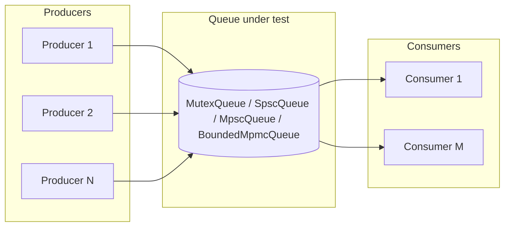
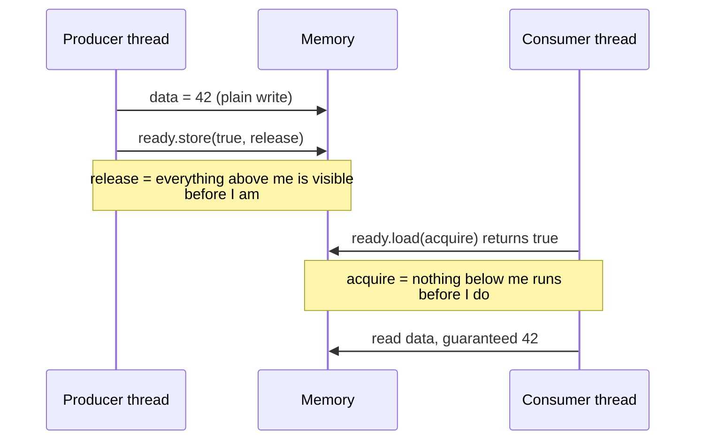
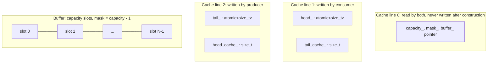
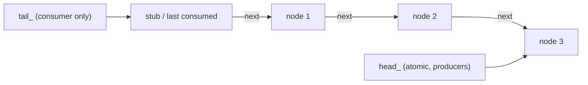
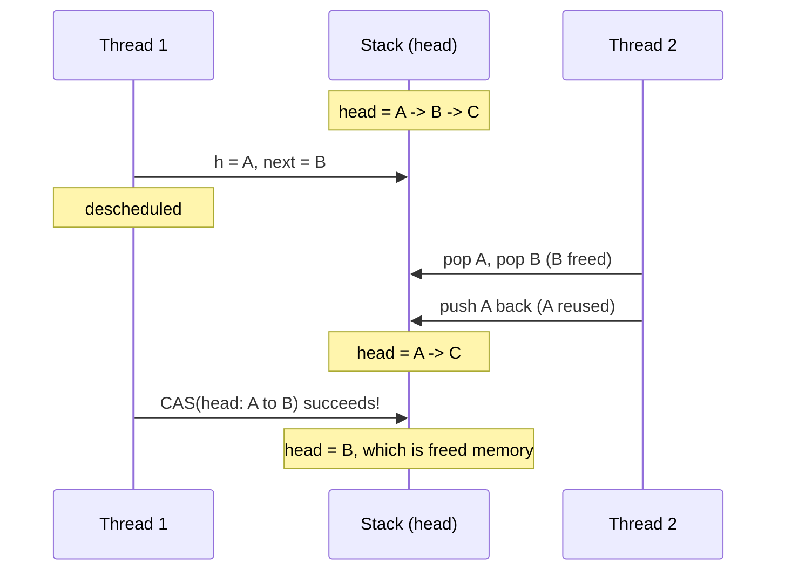
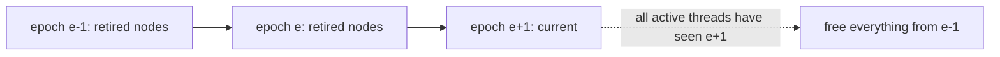
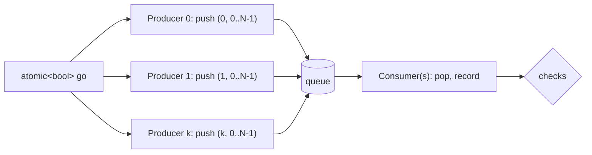

# Atom: Lock-free Concurrency Library

Concurrency primitives built from atomics, not `std::mutex`: SPSC and MPSC queues,
explicit memory ordering, and memory reclamation, stress-tested under ThreadSanitizer.

What gets built:

- **SPSC queue:** one producer, one consumer, a ring buffer.
- **MPSC queue:** many producers, one consumer (Vyukov's linked queue).
- **Explicit memory ordering:** every atomic operation names its ordering, with a one-line
  reason. No default `seq_cst`.
- **Memory reclamation:** hazard pointers and epochs, shown on a lock-free (Treiber) stack.
- **Baseline:** a plain mutex-protected queue that everything is measured against.
- **Stretch:** a bounded MPMC queue, so the consumer count can be swept too.

Headline result: **throughput and tail latency vs the mutex queue, by producer/consumer
count** (method in section 9):

| Metric | Meaning |
|---|---|
| **Throughput (ops/sec)** | How many items move from producers to consumers per second at saturation |
| **p50 / p99 / p99.9 latency** | Time from `push` to `pop` of one item: typical, 1-in-100 worst, 1-in-1000 worst |
| **Scaling** | How both numbers change with thread count: producers 1 → 2 → 4 → 7 with one consumer, and producers × consumers with the MPMC stretch queue |

Only a multi-consumer queue can sweep the consumer count. In the core plan every lock-free
queue has one consumer, so the core charts vary producers. The consumer sweep arrives with
`BoundedMpmcQueue` (M9).

The interesting result is not "lock-free is faster". It is *where* it is faster, by how
much, and where it is not (for example, an MPSC queue under heavy producer contention can
lose to a good mutex, because every producer still fights over one cache line).

> Diagrams are **Mermaid**. They render on GitHub, and in VS Code with the
> "Markdown Preview Mermaid Support" extension (open preview with `Cmd+Shift+V`).

---

## Contents

1. [The big picture](#1-the-big-picture)
2. [Vocabulary](#2-vocabulary)
3. [The C++ memory model in one section](#3-the-c-memory-model-in-one-section)
4. [Baseline: MutexQueue](#4-baseline-mutexqueue)
5. [SPSC ring buffer](#5-spsc-ring-buffer)
6. [MPSC queue](#6-mpsc-queue)
7. [Memory reclamation](#7-memory-reclamation)
8. [Testing: proving it is correct](#8-testing-proving-it-is-correct)
9. [Benchmark design](#9-benchmark-design)
10. [Build plan](#10-build-plan)
11. [Repo layout](#11-repo-layout)

---

## 1. The big picture

A queue moves items between threads. The question this project answers is: **what does it
cost to do that safely, and how does the cost change with the number of threads?**



What gets built, in order:

| Structure | Producers | Consumers | Bounded? | Needs reclamation? |
|---|---|---|---|---|
| `MutexQueue` (baseline) | any | any | yes | no |
| `SpscQueue` | 1 | 1 | yes (ring) | no |
| `MpscQueue` (Vyukov linked list) | many | 1 | no | no (only the consumer frees) |
| `BoundedMpmcQueue` (Vyukov sequence ring, stretch) | many | many | yes | no |
| `TreiberStack` | many | many | no | **yes**, this is where HP and EBR come in |

### Why each structure is here

Each one isolates one of the three core problems of lock-free programming:

```
SpscQueue      ordering     "how do I publish data correctly"      1 vs 1, no contention
MpscQueue      contention   "what happens when threads fight"      N vs 1, exchange
TreiberStack   reclamation  "how do I free memory safely"          N vs N, CAS + HP/EBR
```

| Structure | Atomic primitive | Lock? | Reclamation needed? |
|---|---|---|---|
| `MutexQueue` | none | `std::mutex` | no |
| `SpscQueue` | load / store (acquire / release) | no | no (fixed ring) |
| `MpscQueue` | `exchange` + store | no | no (only the consumer frees) |
| `BoundedMpmcQueue` | CAS + load / store | no | no (fixed ring) |
| `TreiberStack` | CAS | no | **yes**: hazard pointers or epochs |

The MPSC queue matters most for the results: it is the most common shape in real systems
(loggers, matching engines, actor mailboxes, runtime task queues), and it produces the main
chart of the project, throughput and latency as producer count grows. It is also a design
lesson. A general linked queue (Michael-Scott) needs hazard pointers or epochs; Vyukov's
design arranges for only the consumer to free nodes, so the reclamation problem never
arises. Avoiding the problem by design beats solving it.

`exchange` vs CAS: `exchange` always succeeds and returns the old value, so it needs no retry
loop. CAS only writes if the current value equals `expected`, so it can fail and needs a
loop. Use `exchange` when there is no condition (MPSC push: "give me the end, tell me who
was there"), and CAS when there is one (stack pop: "only if head is still A").

### Why a stack for reclamation?

The queues above are designed so that only one thread ever frees memory, which sidesteps
the problem. The Treiber stack is the simplest structure where
many threads can free nodes that other threads are still reading. It is the textbook
vehicle for showing why `delete` is unsafe in lock-free code and how hazard pointers and
epochs fix it.

---

## 2. Vocabulary

| Term | Meaning |
|---|---|
| **SPSC / MPSC / MPMC** | Single/multi producer, single/multi consumer |
| **Lock-free** | Some thread always makes progress, even if others are paused mid-operation. A mutex is not lock-free: if the holder is descheduled, everyone waits |
| **Wait-free** | Every thread finishes in a bounded number of its own steps. Stronger than lock-free. The SPSC ring is wait-free |
| **CAS** | Compare-and-swap: `x.compare_exchange_weak(expected, desired)` writes `desired` only if `x == expected` |
| **Memory ordering** | Rules for which writes one thread is guaranteed to see from another. Section 3 |
| **Cache line** | Unit the CPU moves between cores. **128 bytes on Apple Silicon**, 64 on most x86. `config.hpp` picks the right one per platform as `kCacheLine` |
| **False sharing** | Two threads write different variables that happen to sit on one cache line, so the line ping-pongs between cores |
| **ABA** | A pointer reads `A`, changes to `B`, then back to `A`. A CAS cannot tell anything happened. Section 7 |
| **Reclamation** | Deciding when it is safe to free a node another thread might still be reading |
| **Hazard pointer (HP)** | A per-thread published pointer meaning "I am reading this node, do not free it" |
| **Epoch-based reclamation (EBR)** | Threads announce a global epoch number. A node retired in epoch `e` is freed once every thread has moved past `e` |
| **TSan** | ThreadSanitizer: compiler instrumentation that reports data races at runtime |

---

## 3. The C++ memory model in one section

### The problem

Both the compiler and the CPU reorder memory operations as long as the result looks the
same *to the current thread*. Other threads can see the reorder. ARM (your M-series Mac)
reorders much more aggressively than x86, so bugs that never show on Intel will show here.
That is good for testing.

```cpp
// Thread A                       // Thread B
data = 42;                        while (!ready) {}
ready = true;                     print(data);   // may print 0 without ordering
```

### The fix: release / acquire



If an acquire-load reads the value written by a release-store, everything the writer did
before the store **happens-before** everything the reader does after the load. Nearly the
entire SPSC queue is this one pattern.

### The orderings you will use

| Ordering | Guarantees | Use it when |
|---|---|---|
| `relaxed` | Only that this single operation is atomic | Reading a variable only your own thread writes; counters |
| `release` (store) | Earlier reads and writes cannot move after it | Publishing data: "the slot is filled" |
| `acquire` (load) | Later reads and writes cannot move before it | Consuming data: "is the slot filled?" |
| `acq_rel` (RMW) | Both of the above | `exchange` / CAS that both takes and publishes |
| `seq_cst` | acq_rel plus one global order of all seq_cst ops | Store-then-load patterns (hazard pointers). Nothing weaker prevents a store being reordered after a later load |

**Rule for this project:** every atomic operation carries an explicit ordering and a
one-line comment saying *why*. `seq_cst` by default means you never had to think, and the
point is to think.

### Data race = undefined behaviour

Two accesses to the same non-atomic location, at least one a write, with no happens-before
between them, is a data race, and the program is undefined. That is exactly what TSan
detects.

---

## 4. Baseline: MutexQueue

All queues share one interface so tests and benchmarks can be written once:

```cpp
template <class Q>
concept ConcurrentQueue = requires(Q q, typename Q::value_type v) {
    { q.try_push(v) } -> std::same_as<bool>;   // false if full
    { q.try_pop(v) }  -> std::same_as<bool>;   // false if nothing to take right now
};
```

Every queue keeps exactly this `bool` signature, including `MpscQueue`. Its extra
"push half-finished" state (section 6) comes from a second function, `try_pop_ex`, so the
shared tests and benchmarks never need to know about it.

The Treiber stack is not a queue (LIFO, `push` / `pop`), so it gets its own small interface
and only the order-free stress checks (section 8).

`MutexQueue<T>`: a `std::mutex` guarding a fixed-capacity ring buffer (not `std::deque`, so
it does no allocation in the hot path and is a fair comparison with the bounded lock-free
rings).

```
try_push(v):  lock; if full: unlock, return false; buf[tail++ & mask] = v; unlock; return true
try_pop(out): lock; if empty: unlock, return false; out = buf[head++ & mask]; unlock; return true
```

It is correct by construction, so it doubles as the **reference** for the stress tests:
if a test passes on `MutexQueue` and fails on `SpscQueue`, the bug is in the queue, not in
the test.

---

## 5. SPSC ring buffer

One producer, one consumer, fixed power-of-two capacity. Wait-free on both sides.

### Layout



- `head_` and `tail_` are **monotonic 64-bit counters** that never wrap in practice. The
  slot index is `counter & mask`. Full is `tail - head == capacity`, empty is
  `tail == head`. No wasted slot, no ambiguity.
- Each group sits on **its own cache line** (`alignas(kCacheLine)`: 128 bytes on Apple
  Silicon, 64 elsewhere). Without that, every push invalidates the consumer's line and vice
  versa (false sharing).
- The read-only fields get a line too. Both sides read `mask_` and `buffer_` on every call;
  if they share a line with `head_`, each consumer store drags that line away from the
  producer. Aether's ring had exactly this layout with 64-byte padding on an M1. There,
  batched transfers hid the cost (the pipeline measured the same after the fix), so measure
  it here without batching and see whether it shows.

### The cached-index trick

The naive version loads the *other* side's atomic on every call, which drags that cache line
across cores every time. Instead, each side keeps a private copy of the other's index and
only re-reads the atomic when the copy says "full" or "empty". In steady state most
operations touch only their own cache line. This is typically the biggest single speed-up.

Measured on the M1 Pro, it was not: when the consumer keeps up, the queue is almost always
empty, the cached tail is always stale, and every pop reloads it anyway. The padded,
cached-index queue matched the naive one (see `docs/BENCHMARKS.md`, SPSC). The trick pays
when the queue holds a backlog.

### Pseudocode with orderings

```
try_push(v):                                    // producer only
    t = tail_.load(relaxed)                     // only I write tail_
    if t - head_cache_ == capacity:             // looks full by my stale copy
        head_cache_ = head_.load(acquire)       // pairs with consumer's release:
                                                //   consumer has finished reading that slot
        if t - head_cache_ == capacity: return false
    buf[t & mask] = v                           // plain write, nobody else touches this slot
    tail_.store(t + 1, release)                 // publish: slot write visible before tail moves
    return true

try_pop(out):                                   // consumer only
    h = head_.load(relaxed)                     // only I write head_
    if h == tail_cache_:
        tail_cache_ = tail_.load(acquire)       // pairs with producer's release:
                                                //   slot contents are visible
        if h == tail_cache_: return false
    out = move(buf[h & mask])
    head_.store(h + 1, release)                 // hand the slot back to the producer
    return true
```

Why each acquire is needed:
- **Consumer `tail_.load(acquire)`**: without it, the consumer could see the new tail but
  stale slot contents.
- **Producer `head_.load(acquire)`**: without it, the producer could overwrite a slot the
  consumer is still reading.

### Ideas to try once it works (measure each one separately)

- Batch `try_push_n` / `try_pop_n`: one release-store per batch instead of per item.
- Store `T` inline vs storing a pointer: shows the cost of extra indirection.

---

## 6. MPSC queue

Many producers, one consumer. This is Dmitry Vyukov's intrusive-style MPSC linked queue,
used in many runtimes. Unbounded, one atomic `exchange` per push, no CAS loop.

### What it is for

Many threads put items in; exactly one thread takes them out. Think of a restaurant: many
waiters (producers) put orders into one line, one chef (consumer) takes them in order.

Where this shape shows up in real systems:
- **Logger:** every thread sends log lines, one thread writes them to disk.
- **Matching engine (Aether):** several gateways send orders, one engine thread processes them.
- **Actor mailbox / event loop:** anyone can send a message, one actor reads its mailbox.

### Why it is harder than SPSC

In SPSC only one thread ever writes `tail_`, so there is nothing to fight over. In MPSC
**every producer wants to write the same end of the queue**. If two producers read the tail
at the same time and both write into the same place, one item is lost. A mutex fixes that by
making producers take turns; this design does it with one atomic `exchange` instead.

### Structure



Producers append at `head_`. The consumer reads from `tail_`. The node `tail_` points to has
already been consumed (it starts as a dummy "stub"), so the queue is never truly empty of
nodes, which removes the empty-queue special case.

### Pseudocode

```
push(v):                                        // any producer
    n = new Node{ next = nullptr, value = v }
    prev = head_.exchange(n, acq_rel)           // step 1: claim the end. Atomic, so producers
                                                //   are serialised here with no retry loop
    prev->next.store(n, release)                // step 2: link. Publishes n's contents

try_pop(out):                                   // consumer only
    next = tail_->next.load(acquire)            // pairs with step 2
    if next == nullptr: return false
    out = move(next->value)
    delete tail_                                // safe: only the consumer ever frees,
    tail_ = next                                //   and no producer still holds the old tail
    return true
```

### Why `exchange` makes concurrent pushes safe

`exchange` is a single atomic read-modify-write. If eight producers call it at the same
moment, the hardware puts them in some order, and each one gets back a **different** `prev`.
So every producer links onto a different node, and no two ever write the same `next`.

Two producers, A and B, pushing at once:

```
Producer A: exchange returns prev = stub   then  stub->next = A
Producer B: exchange returns prev = A      then  A->next    = B
Result:     stub -> A -> B                 both items present, nothing lost
```

The order between A and B is decided by whoever's `exchange` lands first, which is fine:
the queue only promises FIFO *per producer*, not a global order between producers.

### The catch you must document

Between step 1 and step 2, a producer that gets descheduled leaves the list **temporarily
broken**: `head_` has moved, but the link to the new node does not exist yet. The consumer
sees `next == nullptr` and reports "empty" even though items pushed *after* that node by
other producers are waiting. So:

- Push is wait-free (one `exchange` and one store).
- Pop is **not** lock-free in the strict sense: it can be blocked by a stalled producer.

This is the standard trade-off of this design. Write it down in the README; it is exactly
the kind of detail reviewers look for.

```
 [stub] --> [A]      [B] --> [C]
              x  link not made yet (producer of B paused between step 1 and 2)
head_ -----------------------> [C]

Consumer sees A->next == nullptr and reports "empty", although B and C are waiting.
Once the paused producer runs step 2, the consumer sees them again.
```

### Handling it (without a lock)

A mutex would make the queue blocking, which defeats the point. It is also unnecessary:
this is a **delay, not data loss**. Every item is still in the list, and the paused producer
will finish step 2 as soon as it runs again. The window is two instructions wide, so it only
opens when the OS deschedules a producer at exactly that point.

1. **Consumer retries.** `try_pop` returns `false`; the caller backs off (`cpu_relax()`,
   then `yield`) and tries again, as it would for a truly empty queue.
2. **Tell "empty" from "in progress".** If `tail_->next == nullptr` but
   `head_.load(acquire) != tail_`, a push is half-finished. `try_pop_ex` returns a three-way
   result; plain `try_pop` keeps the shared `bool` interface and reports both as `false`:

   ```
   enum class PopResult { Item, Empty, Retry };
   PopResult try_pop_ex(T& out);
   bool      try_pop(T& out) { return try_pop_ex(out) == PopResult::Item; }
   ```

   On `Retry` the consumer should spin briefly rather than sleep, because the item is about to
   appear.
3. **Measure it.** Count `Retry` results in the benchmark. If the count is tiny compared with
   total pops, the trade-off is cheap in practice, and the README can say so with numbers.

The consumer cannot "help" finish the push, because it cannot reach node B: the only pointer
to it from the list is the link that has not been written yet.

If a strictly lock-free consumer were required, the option would be the Michael-Scott queue,
where threads help each other finish half-done operations. That brings back hazard pointers
or epochs. Note that `BoundedMpmcQueue` has the same property: a producer that claimed a cell
but has not yet written it holds up the consumer at that cell.

### SPSC vs MPSC vs mutex at a glance

| | `SpscQueue` | `MpscQueue` (Vyukov) | `MutexQueue` |
|---|---|---|---|
| Producers | 1 | many | many |
| Push cost | 1 release store | 1 `exchange` + 1 release store | lock + unlock |
| Where threads contend | Nowhere | All producers on the cache line holding `head_` | All threads on one lock |
| Memory | Fixed ring | One `new` per push (node pool later) | Fixed ring |
| Progress | Wait-free both sides | Push wait-free; pop can be blocked by a paused producer | Blocking |

The MPSC benchmark exists to show how the gap between the last two columns changes as
producers go from 1 to 8.

### Allocation

`new` per push puts `malloc` in the hot path, and `malloc` has its own locks. Measure it
as-is first. Then, as an optimisation, try a node pool and compare. The benchmark should
report both numbers.

### Stretch: BoundedMpmcQueue (Vyukov sequence ring)

A bounded ring where each cell carries an atomic `seq`. It works for many producers *and*
many consumers, which lets the benchmark sweep consumer count too.

```
cells[i].seq = i initially

try_push(v):
    pos = enq_.load(relaxed)
    loop:
        cell = cells[pos & mask]
        diff = cell.seq.load(acquire) - pos
        if diff == 0:   if enq_.CAS_weak(pos, pos + 1, relaxed): break   // slot claimed
        elif diff < 0:  return false                                      // full
        else:           pos = enq_.load(relaxed)                          // someone beat me
    cell.data = v
    cell.seq.store(pos + 1, release)            // "filled, for the reader at pos"
    return true

try_pop(out):
    pos = deq_.load(relaxed)
    loop:
        cell = cells[pos & mask]
        diff = cell.seq.load(acquire) - (pos + 1)
        if diff == 0:   if deq_.CAS_weak(pos, pos + 1, relaxed): break
        elif diff < 0:  return false                                      // empty
        else:           pos = deq_.load(relaxed)
    out = move(cell.data)
    cell.seq.store(pos + capacity, release)     // "empty, for the writer one lap later"
    return true
```

(`diff` is computed as a signed difference.)

---

## 7. Memory reclamation

### The problem, shown on a Treiber stack

```
push(n):
    n->next = head_.load(relaxed)
    while !head_.CAS_weak(n->next, n, release, relaxed): {}

pop():
    h = head_.load(acquire)
    while h != nullptr:
        next = h->next                          // DANGER: h may already be freed
        if head_.CAS_weak(h, next, acquire, acquire): break
    return h                                    // when can we delete h?
```

Two separate bugs hide in `pop`:

1. **Use-after-free.** Thread 1 loads `h`, then gets descheduled. Thread 2 pops `h` and
   deletes it. Thread 1 wakes up and reads `h->next` from freed memory.
2. **ABA.** Even without crashing, the CAS can succeed wrongly:



You cannot simply never free (memory leaks forever), and you cannot free right away. You
need to know when **no thread can still be holding a pointer to the node**. That is what
reclamation schemes answer.

### Hazard pointers (Michael, 2004)

Each thread owns a few published slots, `hp[thread][k]`. Before dereferencing a shared
pointer, a thread writes it into its slot: "I am using this, do not free it."

```
pop():
    loop:
        h = head_.load(acquire)
        if h == nullptr: return nullptr
        hp[me].store(h, seq_cst)                // publish
        if head_.load(seq_cst) != h: continue   // re-check: h might have been removed
                                                //   before my publish became visible
        next = h->next                          // safe now: h cannot be freed
        if head_.CAS(h, next): break
    hp[me].store(nullptr, release)              // h is unlinked and mine: only I will retire it
    v = move(h->value)                          // read BEFORE retire: retire() may run scan(),
                                                //   which can delete h on the spot
    retire(h)
    return v

retire(p):
    my_retired.push(p)
    if my_retired.size() >= R: scan()           // R around 2 x total hazard slots

scan():
    hazards = set of every hp[*] value          // seq_cst loads
    for p in my_retired:
        if p not in hazards: delete p           // nobody is protecting it
        else: keep it for the next scan
```

Why `seq_cst` for publish and re-check: the publish is a **store followed by a load** of a
different variable. Acquire/release does not stop a store from being reordered after a later
load; only `seq_cst` (or a full fence) does. Get this wrong and the re-check passes while
another thread's scan misses your hazard.

Hazard pointers also fix ABA here: while `A` is protected it cannot be freed, so it cannot
come back as a new allocation.

### Epoch-based reclamation (Fraser, 2004)

Cheaper per operation: instead of protecting every pointer, a thread protects a whole
**critical section**.



```
global_epoch: atomic<uint64>
per thread:   local_epoch, active flag      (published together, see below)
              limbo[3]: this thread's retired lists, each tagged with an epoch

enter():   loop:
               e = global_epoch.load(seq_cst)
               publish (active = true, e) with a seq_cst store
               if global_epoch.load(seq_cst) == e: break     // announced a current epoch
           if e moved since my last enter():
               local_epoch = e
               free every limbo list whose tag + 2 <= e
exit():    active = false (release)
retire(p): tag = local_epoch + 1                 // NOT local_epoch, see below
           my limbo[tag % 3].push(p)             // only inside enter()/exit()

try_advance():
    e = global_epoch.load(seq_cst)
    if every active thread has local_epoch == e:
        global_epoch.CAS(e, e + 1)
```

Each thread frees only its **own** limbo lists, so no list is shared and no list needs a
lock. A node tagged `t` is freed once its owner sees the global epoch at `t + 2`: to get
there, every active thread had to be seen in epoch `t + 1`, so every thread that could have
read the node has since left its critical section.

**Why the tag is `local_epoch + 1`.** An earlier version of this design tagged a node with
the retiring thread's own epoch `L`, and was wrong. While that thread is active at `L`, the
global epoch can already be `L + 1` (it only needs every active thread to be at `L`), and a
reader that enters at `L + 1` can pick up the node before it is unlinked. Tagged `L`, the node
is freed at `L + 2`, and advancing to `L + 2` only needs that reader to be at `L + 1`, which
it still is: use-after-free. Tagged `L + 1`, it is freed at `L + 3`, which that reader blocks
until it leaves. The cost is that memory is held one epoch longer.

Publish `active` and `local_epoch` as **one atomic word** (for example `epoch << 1 | 1`).
As two separate stores, `try_advance` could see a thread as active with an epoch it has not
written yet. The publish must be `seq_cst` for the same reason as the hazard-pointer publish:
it is a store followed by loads of shared pointers.

### Choosing between them

| | Hazard pointers | Epochs |
|---|---|---|
| Cost per node access | One `seq_cst` store plus a re-check | Near zero (one announce per operation) |
| Memory if a thread stalls | **Bounded**: at most H nodes stay unfreed | **Unbounded**: one stuck thread blocks all freeing |
| Complexity | Every pointer dereference needs protecting | Wrap operations in enter/exit |
| Good for | Long-lived readers, memory-sensitive systems | Throughput, short operations |

The benchmark should show the throughput gap, and a test should show the stalled-thread
memory growth for EBR.

---

## 8. Testing: proving it is correct

A lock-free structure that "seems to work" proves nothing. The tests are designed to make
races likely and to detect them when they happen.

### Stress test (one template, every structure)



Each item is `(producer_id, seq)`. After all threads join:

1. **No loss, no duplicates:** every `(id, seq)` seen exactly once.
2. **Per-producer FIFO (queues only):** for each producer, seq arrives strictly increasing
   (per consumer for multi-consumer queues). The Treiber stack is LIFO, so it skips this check.
3. **No garbage:** no value that was never pushed.

All threads spin on `go` before starting so they really overlap. Run with N in the millions,
and repeat many times. Then add **jitter**: occasionally `std::this_thread::yield()` at random
points inside the test loop, which changes interleavings a lot.

### Sanitizers

| Build | Catches | Use for |
|---|---|---|
| `tsan` | Data races, bad orderings that cause races | Every structure |
| `asan` | Use-after-free, double free (leaks too, but not on macOS: Apple's ASan has no leak detection) | **Reclamation**: a hazard-pointer bug shows up as a use-after-free |
| `leaks --atExit -- ./atom_tests` | Leaks, on macOS | After the reclamation milestones |
| `release` | Nothing; it is for speed | Benchmarks only |

Two TSan caveats to write down:
- TSan only reports races that **actually happen** in that run. Clean TSan is evidence, not
  proof, which is why tests run many times with jitter.
- TSan does not fully model standalone `std::atomic_thread_fence`. Prefer orderings on the
  atomic operations themselves (this design already does).
- **TSan on macOS (Apple clang 21) does not report races through `memcpy`.** A trivially
  copyable 16-byte struct is copied with `memcpy`, so a test item of that shape hid the
  negative test's race completely. The test `Item` is therefore copied field by field
  (`tests/stress.hpp`). Check that the negative test fails before trusting a green run.

### Negative test (do this once, it is very convincing)

Deliberately weaken one ordering, for example make the SPSC `tail_.store` `relaxed`, and
show that TSan reports a race. Put the TSan output in the docs. It proves the tests can
actually catch the bug they claim to catch.

---

## 9. Benchmark design

### Two questions, two modes

| Mode | Question | How |
|---|---|---|
| **Throughput** | How fast can it go flat out? | Producers push as fast as possible for a fixed item count; report items/sec |
| **Latency** | How long does one item wait at a realistic load? | Producers push at a **fixed rate**, the same for every queue in a configuration (25% of the slowest queue's throughput there); consumer records `now - send_time` per item |

Do not measure latency at saturation: the queue fills up and you just measure queue
depth.

**Coordinated omission:** in latency mode, `send_time` is the time the item was *scheduled*
to be sent, not when the producer actually got around to it. Otherwise a stall hides the
latency of every item that should have been sent during the stall.

### The matrix

| Experiment | Queues compared | Sweep |
|---|---|---|
| SPSC | `SpscQueue` vs `MutexQueue` | 1 producer, 1 consumer; capacity 1K / 64K |
| MPSC | `MpscQueue`, `MutexQueue` (+ `MpscQueue` with pool and `BoundedMpmcQueue` once M9 exists) | producers 1, 2, 4, 6, 7; 1 consumer |
| MPMC (stretch) | `BoundedMpmcQueue` vs `MutexQueue` | producers x consumers in {1, 2, 4}^2 |
| Stack | Treiber + HP, Treiber + EBR, mutex stack | threads 1, 2, 4, 8, 50/50 push/pop |

The MPSC sweep stops at 7 producers because 7 producers plus 1 consumer fills the 8
performance cores of an M1 Pro; the rule below explains why it must not go past that.
Adjust the top of each sweep to your core count.

Rules that keep the comparison fair:
- Same waiting for every queue when `try_push`/`try_pop` fails: in throughput mode spin with
  `cpu_relax()` a few times, then `yield`; in latency mode spin only. On macOS `sched_yield()`
  lowers the caller's priority for a while, and a mostly idle consumer that kept yielding put
  milliseconds into every queue's p99, lock-free or not.
- At 50% load the latency runs saturated (the clock reads and histogram add work per item),
  so the load is 25%, and a run that falls more than 5% behind its rate is flagged.
- Total threads at most the number of performance cores. Oversubscription measures the
  scheduler, not the queue.
- Warm-up run first, then 5 runs; report the median and spread.
- Item is a small struct (`uint64 seq`, `uint64 timestamp`) passed by value.

### Measuring latency

- Per-thread histogram (log-linear buckets, like HdrHistogram), merged at the end. Never
  share a histogram or a vector between threads in the hot path; that adds its own contention.
- Report p50, p99, p99.9 and max.
- **Clock resolution on Apple Silicon is about 41 ns** (24 MHz counter; Aether measured the
  same). Anything below that is quantised. Say so next to the numbers.
- The timestamp is `mach_absolute_time()` (about 6 ns per read), not `steady_clock::now()`
  (about 16 ns), because it is read twice per item on the measured path.

### Output

The benchmark writes CSV, and `scripts/plot.py` draws the charts:

```
experiment,queue,mode,producers,consumers,capacity,run,items,ops_per_sec,p50_ns,p99_ns,p999_ns,max_ns,target_rate,pop_retries,saturated
```

Charts to make: throughput vs producer count (one line per queue), and p99 / p99.9 vs
producer count.

### Known limits (macOS)

- No thread pinning, so numbers are noisier than on Linux, and the OS may put a thread on an
  efficiency core.
- `std::mutex` behaviour depends on the OS implementation. That is part of what you are
  measuring, so record the OS version.
- If you want cleaner numbers later, rerun on Linux with pinning, as was done for Aether.

---

## 10. Build plan

Each milestone has a clear "done when". Do not start the next one until the current one
passes TSan.

| # | Milestone | Done when |
|---|---|---|
| M0 | CMake, presets (`debug`, `release`, `tsan`, `asan`), `config.hpp` (`kCacheLine`: 128 on Apple arm64, 64 elsewhere; `cpu_relax()`) | A smoke test builds and passes in all four presets |
| M1 | `MutexQueue` plus the generic stress-test template | Stress test passes 4P/1C, N = 1M, in `tsan` |
| M2 | `SpscQueue`, naive (no cached indices) | Stress test passes in `tsan`; negative test shows TSan catching a weakened ordering |
| M3 | `SpscQueue` with padding and cached indices | Still passes; first SPSC benchmark shows the speed-up over M2 and over the mutex |
| M4 | `MpscQueue` (Vyukov) | Stress test passes 8P/1C in `tsan` and `asan` |
| M5 | Benchmark harness: throughput mode, latency mode, CSV, plots | MPSC sweep 1..7 producers produces throughput and tail-latency charts against `MutexQueue` |
| M6 | `TreiberStack` with no reclamation (leaks on purpose) | Correct under `tsan`; `leaks --atExit` reports the leak (ASan on macOS has no leak detection) |
| M7 | Hazard pointers | Stack passes `tsan` and `asan` with no use-after-free; `leaks --atExit` reports 0 leaks, and a test checks every node was freed |
| M8 | Epoch-based reclamation | Same, plus a test showing memory growth when one thread stalls |
| M9 | `BoundedMpmcQueue`, node pool for `MpscQueue` (stretch) | Added to the benchmark matrix |
| M10 | `README.md` results, `docs/BENCHMARKS.md` | Numbers, charts and limits written up, like Aether |

---

## 11. Repo layout

As built. Beyond the original plan: `queue_concept.hpp` (the shared interface),
`tests/negative_spsc.cpp` (the TSan negative test), `tests/test_bounded_mpmc_queue.cpp`,
`docs/results/` (raw CSV and machine info), `docs/img/` (charts) and `.clangd`.

```
atom/
├── CMakeLists.txt                                                      (M0)
├── CMakePresets.json             debug / release / tsan / asan         (M0)
├── include/atom/
│   ├── config.hpp                kCacheLine, cpu_relax(), Backoff      (M0)
│   ├── queue_concept.hpp         ConcurrentQueue, QueueItem            (M1)
│   ├── mutex_queue.hpp           baseline                              (M1)
│   ├── spsc_queue.hpp            section 5                             (M2, M3)
│   ├── mpsc_queue.hpp            section 6                             (M4)
│   ├── bounded_mpmc_queue.hpp    section 6, stretch                    (M9)
│   ├── treiber_stack.hpp         section 7                             (M6)
│   └── reclaim/
│       ├── hazard_pointer.hpp    section 7                             (M7)
│       └── epoch.hpp             section 7                             (M8)
├── tests/
│   ├── CMakeLists.txt                                                  (M0)
│   ├── smoke.cpp                 builds in every preset                (M0)
│   ├── stress.hpp                generic stress-test template          (M1)
│   ├── test_mutex_queue.cpp                                            (M1)
│   ├── test_spsc_queue.cpp                                             (M2, M3)
│   ├── negative_spsc.cpp         TSan must catch a relaxed publish     (M2)
│   ├── test_mpsc_queue.cpp                                             (M4)
│   ├── test_bounded_mpmc_queue.cpp                                     (M9)
│   └── test_treiber_stack.cpp                                          (M6 to M8)
├── bench/
│   ├── CMakeLists.txt                                                  (M5)
│   ├── histogram.hpp             log-linear latency histogram          (M5)
│   └── bench_queues.cpp          throughput + latency modes, CSV out   (M5)
├── scripts/plot.py               CSV to charts                         (M5)
├── docs/
│   ├── ATOM_DESIGN.md            this file
│   ├── BENCHMARKS.md             method, results, limits               (M10)
│   ├── img/                      charts from scripts/plot.py           (M10)
│   └── results/                  raw CSV, run log, machine info        (M10)
└── README.md                                                           (M10)
```

## Further reading

- Preshing on Programming: "Acquire and Release Semantics", "The Synchronizes-With Relation"
- cppreference: `std::memory_order`
- Dmitry Vyukov, 1024cores.net: "Intrusive MPSC node-based queue", "Bounded MPMC queue"
- Maged Michael (2004): "Hazard Pointers: Safe Memory Reclamation for Lock-Free Objects"
- Keir Fraser (2004): "Practical lock-freedom" (epoch-based reclamation)
- Anthony Williams: *C++ Concurrency in Action*, chapters 5 and 7
