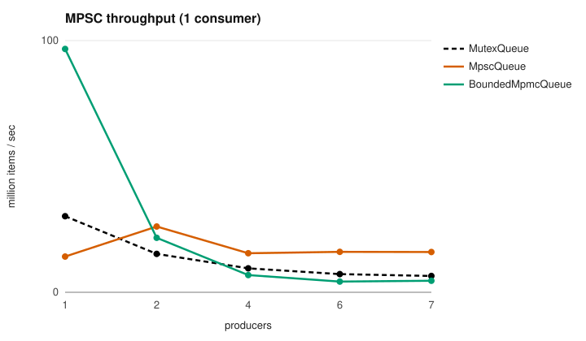
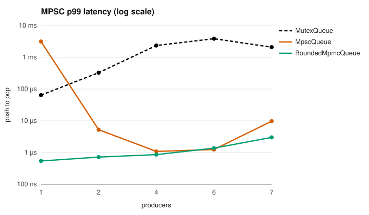
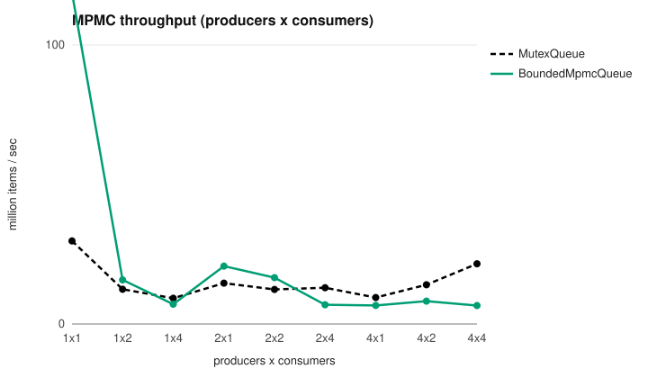
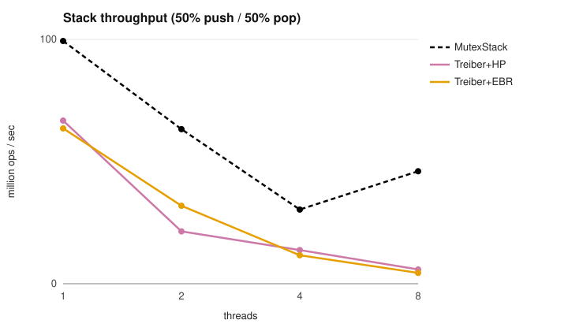

# Atom benchmarks

Throughput and tail latency of each lock-free structure against its mutex baseline, as the
number of producers and consumers grows.

- Raw data: [`results/results.csv`](results/results.csv) (one row per run), run log:
  [`results/run_log.txt`](results/run_log.txt), all tables: [`results/tables.md`](results/tables.md)
- Reproduce: `./build/release/bench/atom_bench --out docs/results/results.csv`, then
  `python3 scripts/plot.py docs/results/results.csv --out docs/img --tables docs/results/tables.md`

## Machine

| | |
|---|---|
| CPU | Apple M1 Pro: 8 performance + 2 efficiency cores, 128-byte cache lines |
| OS | macOS 27.0 |
| Compiler | Apple clang 21.0.0, `-O3`, C++20 |
| Load | Desktop session with other apps open; load average about 4.5 during the run |

## Method

| | |
|---|---|
| Item | 16-byte struct (`seq`, `timestamp`), by value |
| Throughput mode | Producers push a fixed count flat out (4M items; 20M for SPSC); items / elapsed time |
| Latency mode | Producers push at a fixed total rate, the same for every queue in a configuration: 25% of the slowest queue's median throughput there. Latency is pop time minus *scheduled* send time, so a late producer cannot hide its delay (coordinated omission) |
| Runs | 1 warm-up, then 5; every number below is the median of the 5 |
| Waiting | Throughput mode: spin 64 times, then `yield`. Latency mode: spin only (see "Limits") |
| Threads | Never more than the 8 performance cores; highest QoS class to ask for them |
| Clock | `mach_absolute_time()`, 24 MHz: about 41 ns resolution, so anything under ~100 ns is coarse |
| Histogram | Log-linear, 32 buckets per power of two: values reported up to ~3% high |

No latency run fell behind its offered rate (each run is checked; none was flagged).

## Headline: MPSC, 1 to 7 producers, 1 consumer

| producers | MutexQueue | MpscQueue | BoundedMpmcQueue |
|---|---|---|---|
| 1 | 30.2 | 14.2 | **96.7** |
| 2 | 15.2 | **26.1** | 21.7 |
| 4 | 9.5 | **15.5** | 6.8 |
| 6 | 7.2 | **16.1** | 4.3 |
| 7 | 6.5 | **16.0** | 4.6 |

Million items per second.

| producers | offered load | queue | p50 | p99 | p99.9 |
|---|---|---|---|---|---|
| 1 | 3.55 M/s | MutexQueue | 9.2 µs | 64.5 µs | 151.6 µs |
| 1 | 3.55 M/s | MpscQueue | 203 ns | 3.1 ms | 3.9 ms |
| 1 | 3.55 M/s | BoundedMpmcQueue | 111 ns | 543 ns | 20.5 µs |
| 2 | 3.81 M/s | MutexQueue | 17.9 µs | 327.7 µs | 1.0 ms |
| 2 | 3.81 M/s | MpscQueue | 251 ns | 5.2 µs | 34.8 µs |
| 2 | 3.81 M/s | BoundedMpmcQueue | 195 ns | 719 ns | 24.1 µs |
| 4 | 1.71 M/s | MutexQueue | 32.8 µs | 2.4 ms | 2.7 ms |
| 4 | 1.71 M/s | MpscQueue | 735 ns | 1.1 µs | 28.2 µs |
| 4 | 1.71 M/s | BoundedMpmcQueue | 407 ns | 863 ns | 24.1 µs |
| 6 | 1.07 M/s | MutexQueue | 27.1 µs | 3.9 ms | 5.4 ms |
| 6 | 1.07 M/s | MpscQueue | 815 ns | 1.2 µs | 84.0 µs |
| 6 | 1.07 M/s | BoundedMpmcQueue | 439 ns | 1.4 µs | 54.3 µs |
| 7 | 1.15 M/s | MutexQueue | 14.6 µs | 2.1 ms | 2.9 ms |
| 7 | 1.15 M/s | MpscQueue | 799 ns | 9.7 µs | 167.9 µs |
| 7 | 1.15 M/s | BoundedMpmcQueue | 431 ns | 3.0 µs | 104.4 µs |

p99.9: [`img/mpsc_latency_p999.svg`](img/mpsc_latency_p999.svg).

### What it shows

- **Throughput: the Vyukov MPSC queue is the only one that holds up as producers are
  added.** From 2 producers on it stays at 15 to 26 M/s, 1.6 to 2.5 times the mutex queue,
  whose throughput falls with every producer added. Each push is one `exchange`, which
  always succeeds, so contention costs a cache-line transfer, not retries.
- **BoundedMpmcQueue collapses with producers.** It is the fastest at 1 producer (97 M/s) and
  the slowest from 4 on (under 7 M/s): every producer CASes the same `enq_` counter, and a
  CAS that loses must reload and try again. This is the `exchange` vs CAS difference from
  the design doc, measured.
- **Latency: lock-free p50 is 100 to 800 ns; the mutex queue's is 9 to 33 µs.** The mutex
  queue's p99 reaches milliseconds from 4 producers, because the consumer polling an empty
  queue takes the lock over and over and producers queue behind it.
- **MpscQueue with one producer has a 3 ms p99** while its p50 is 203 ns. That is not a
  stall: no single push or pop took more than 61 µs. A rate sweep on its own (1P1C, outside
  the harness) shows a single producer saturates between 1 M/s (p99 ~30 µs) and 2 M/s (p99
  in ms) when items are handed over one at a time, against 14 M/s flat out. Each paced push
  pays an allocation of memory freed by another thread (p50 83 ns, measured), an
  `exchange`, and a store into a line the consumer holds, with nothing to amortise them over.
  Two producers split that cost, which is why the p99 falls to 5 µs at 2 producers. A node
  pool (stretch goal M9) is the fix this points to.

## SPSC: 1 producer, 1 consumer

| capacity | queue | throughput | p50 | p99 | p99.9 |
|---|---|---|---|---|---|
| 1024 | MutexQueue | 27.1 M/s | 12.8 µs | 65.5 µs | 118.8 µs |
| 1024 | NaiveSpscQueue | 32.6 M/s | 115 ns | 639.0 µs | 999.4 µs |
| 1024 | SpscQueue | 32.0 M/s | 109 ns | 213.0 µs | 483.3 µs |
| 65536 | MutexQueue | 30.3 M/s | 7.7 µs | 53.2 µs | 122.9 µs |
| 65536 | NaiveSpscQueue | 11.3 M/s | 147 ns | 1.7 µs | 16.4 µs |
| 65536 | SpscQueue | 10.6 M/s | 109 ns | 2.4 µs | 15.4 µs |

The surprise of the project. **The padded, cached-index SpscQueue is no faster than the naive
one, and with 64K slots both are slower than the mutex queue** in throughput. The design doc
predicted the cached indices would be "the biggest single speed-up"; here they were not.

Why: in this test the consumer keeps up with the producer, so the queue is nearly always
empty. The cached copy of `tail_` is then always stale, every pop reloads `tail_`, and each
item costs a round trip of `tail_`'s cache line plus the slot's line between the two cores;
the cache saves nothing. The trick pays when the queue holds a backlog. The bounded MPMC ring
reaches ~100 M/s in the same 1:1 setting because the consumer polls a sequence number that
sits in the same cache line as the data, so one transfer brings several items. A small
standalone test (no harness) gave the same order: SPSC 30 to 42 M/s, naive 42 to 46, MPMC
62 to 73, mutex 24 to 28.

The 64K ring is slower than the 1K ring for the lock-free queues. A plausible cause is that 64K
slots of 16 bytes (1 MB) no longer stay in the cores' caches, so the slots themselves miss;
this was not isolated.

Latency is where SPSC wins clearly: p50 ~110 ns against 8 to 13 µs for the mutex queue.

## MPMC: producers x consumers (stretch)

| P x C | MutexQueue | BoundedMpmcQueue | Mutex p99 | BoundedMpmc p99 |
|---|---|---|---|---|
| 1x1 | 29.8 | **118.7** | 67.6 µs | **607 ns** |
| 1x2 | 12.4 | **15.8** | 184.3 µs | **575 ns** |
| 1x4 | **9.2** | 7.1 | 163.8 µs | **559 ns** |
| 2x1 | 14.7 | **20.7** | 88.1 µs | **671 ns** |
| 2x2 | 12.4 | **16.6** | 77.8 µs | **671 ns** |
| 2x4 | **13.0** | 6.9 | 241.7 µs | **655 ns** |
| 4x1 | **9.5** | 6.6 | 4.5 ms | **1.2 µs** |
| 4x2 | **14.1** | 8.2 | 94.2 µs | **703 ns** |
| 4x4 | **21.6** | 6.6 | 671.7 µs | **3.5 µs** |

Throughput in million items/sec. Full percentiles: [`results/tables.md`](results/tables.md).

**With 4 threads on either side the mutex queue moves more items per second; the lock-free
ring keeps a p99 about 100 to 3700 times lower at every point.** With several threads on each side, every
lock-free CAS that loses is wasted work on a contended line, while a mutex lets one thread
at a time do a whole push or pop. That is the trade lock-free makes: no thread ever waits for
a descheduled lock holder, so the tail stays short, but raw throughput under heavy contention
can be lower.

## Stacks: Treiber + reclamation vs a mutex stack

| threads | MutexStack | Treiber+HP | Treiber+EBR |
|---|---|---|---|
| 1 | **99.4** | 66.8 | 63.6 |
| 2 | **63.3** | 21.4 | 31.9 |
| 4 | **30.3** | 13.8 | 11.6 |
| 8 | **46.0** | 5.9 | 4.4 |

Million operations per second, 50% push / 50% pop.

**The mutex stack wins at every thread count**, and the gap grows with threads. This is not
a fair fight on allocation: the mutex stack is a `std::vector` that never allocates after
warm-up, while every Treiber push allocates a node and every pop retires one (freed later,
often by another thread). And every Treiber operation is a CAS on one `head_` word, which
retries under contention. The point of the lock-free stack here is reclamation, not speed:
it is correct with nodes freed concurrently, and the tests show it. A lock-free stack with
per-thread node caches would be the next step to make the comparison fair.

Hazard pointers vs epochs: similar throughput, neither consistently ahead (EBR ahead at 2
threads, HP at 4 and 8). The memory difference, which matters more, is shown by the tests, not
the benchmark: with one thread stalled inside a critical section, EBR held at least 39,800 of 40,000 popped
nodes unfreed (the test's threshold), while hazard pointers stayed under their bound of
2 x 512 + 1.

## Limits

- **macOS has no thread pinning.** The OS may move a thread between clusters or onto an
  efficiency core, and other apps were running (load average ~4.5). Single runs vary: the MPSC
  6-producer MpscQueue p99 was 1.0 to 1.3 µs in four runs and 4.1 ms in one. Medians of 5
  runs are reported; the CSV has every run.
- **Latency mode spins instead of yielding.** On macOS `sched_yield()` lowers the caller's
  priority for a while; with the yielding backoff, every queue's p99 at 4+ producers was in
  milliseconds, lock-free or not. Spinning is what a latency-sensitive system would do, and it
  is the same for every queue.
- **`Retry` counts are polls, not items.** `MpscQueue` reported 7 to 12 million polls per run
  that saw a push half-finished (in runs of 0.3 to 0.9 million items), because the consumer spins
  right behind the producers and sees the same in-progress push many times. It says the window
  is hit often when the consumer is that close, not that items are lost (the stress tests
  check that).
- **Clock resolution is ~41 ns**, so p50 values around 100 to 200 ns are a few ticks.
- **The items are tiny (16 bytes).** Larger items shift the cost toward copying, and the
  cache-line effects above would change.
- For cleaner numbers, rerun on Linux with threads pinned to cores, as was done for Aether.
